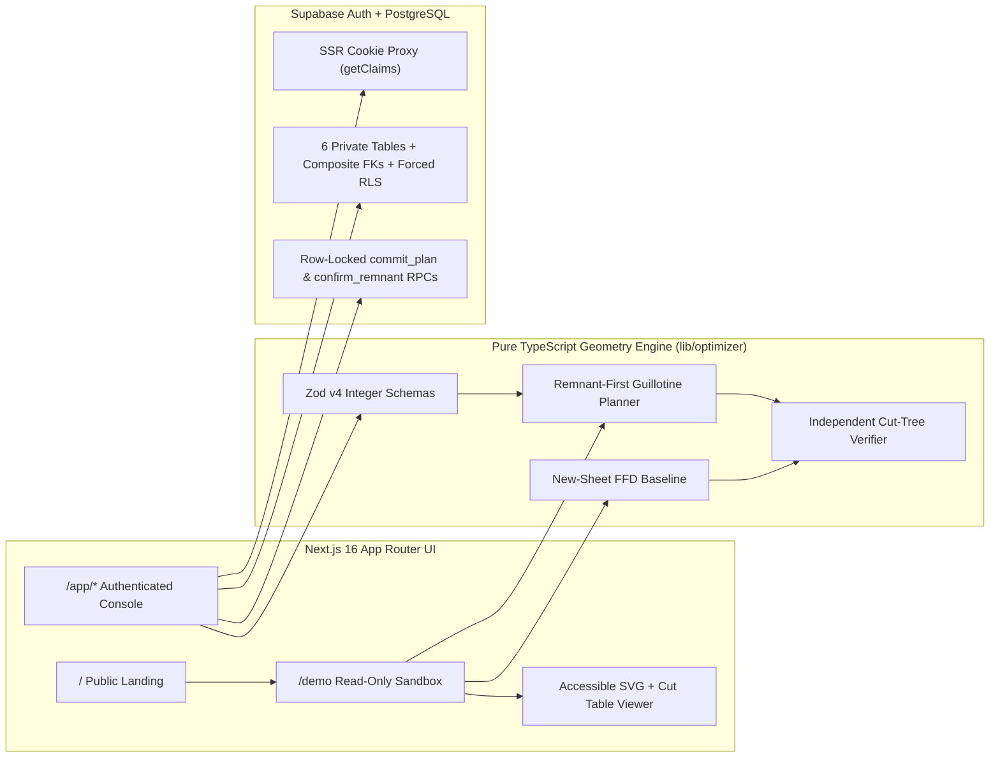

# ReCut OS — Intelligent Material Recovery

**Remnant-first 2D guillotine sheet-cutting planner, independent geometry verifier, and inventory-safe workshop ledger.**

ReCut OS helps small woodworking, acrylic, and sheet-material fabrication workshops reuse the rectangular offcuts already sitting on their racks before buying new full standard sheets. Every layout is generated as an executable **binary guillotine cut tree** with real saw-blade kerf subtraction, verified by an independent geometric checker, and compared transparently against a deterministic new-sheet-only baseline.

> **Truthfulness & Scope Notice:** ReCut OS is an engineering MVP built for Arbiter Hacks. Benchmark numbers in [`docs/benchmarks.md`](./docs/benchmarks.md) and inside the public `/demo` are computed live from deterministic fixture inputs — they are **not** claims of deployed customer pilots or verified carbon reductions. Furthermore, ReCut OS implements a **bounded multi-start guillotine heuristic**, not a global mixed-integer programming optimum.

---

## Core Capabilities

1. **One-Click Public Interactive Sandbox (`/demo`)**
   - Works immediately without sign-in or database writes.
   - Evaluates 6 deterministic fixtures (including zero-savings and infeasible oversized-part cases), lets users toggle individual physical remnants or adjust saw kerf width (`0–5 mm`), and updates both the interactive SVG cutting diagram and textual cut-sequence ledger live.
2. **Kerf-Aware Constructive Guillotine Engine (`lib/optimizer/guillotine.ts`)**
   - Operates strictly in safe integer millimeters (`mm`), square millimeters (`mm²`), and integer minor currency units (paise/cents).
   - Enforces material match, standard sheet bounds, 90° rotation permissions, and conservative grain-axis alignment (`none`, `x` along width, `y` along height).
   - Allocates owned `available` remnants first, runs a post-pack stock consolidation pass so tiny remnants are not needlessly consumed when an already-opened sheet has room, and ranks candidates lexicographically:
     1. Feasible placement of 100% of expanded part instances
     2. Minimum modeled new-sheet purchase spend
     3. Minimum true physical loss (`unusableScrapAreaMm2 + kerfLossAreaMm2`)
     4. Minimum guillotine cut count
     5. Minimum opened existing stock units
3. **Independent Cut-Tree Verifier (`lib/optimizer/verify.ts`)**
   - Treats all optimizer output as untrusted.
   - Replays every `CutNode` binary tree from root stock bounds `(0, 0, widthMm, heightMm)`, verifying positive child splits, exact kerf strip geometry, pairwise non-overlap, 1-to-1 part bijection, rotation/grain legality, and exact `1 mm²` area conservation:
     $$\sum A_{\text{parts}} + \sum A_{\text{recoverable}} + \sum A_{\text{scrap}} + \sum A_{\text{kerf}} = \sum A_{\text{opened}}$$
4. **Honest Baseline & Accounting (`lib/optimizer/baseline.ts`, `lib/optimizer/metrics.ts`)**
   - Compares every plan against a deterministic **New-Sheet-Only First-Fit Decreasing (FFD) Guillotine** baseline using identical part quantities, kerf, grain, and rotation rules.
   - Separates **modeled new-sheet purchase spend avoided** from **physical material loss**: existing remnants carry zero new purchase cost (sunk cost), and consuming them draws down rack inventory.
5. **Authenticated Multi-Tenant Persistence & Row-Locked Commits (`supabase/migrations/`)**
   - Cookie-backed SSR authentication via `@supabase/ssr` and Next.js `proxy.ts`.
   - Forced PostgreSQL Row Level Security (`ENABLE` + `FORCE ROW LEVEL SECURITY`) on all 6 private tables (`materials`, `stock_items`, `jobs`, `job_parts`, `plans`, `plan_sheets`) plus composite `(parent_id, user_id)` foreign keys blocking cross-tenant references.
   - Atomic `public.commit_plan(uuid)` RPC locks allocated `stock_items` in deterministic UUID order (`FOR UPDATE`), blocks stale double-spending with an explicit conflict error, marks used stock `consumed`, and stages qualifying residual rectangles as `pending_confirmation` until physically measured on the shop floor (`public.confirm_remnant`).

---

## System Architecture



---

## Measured Benchmark Summary (`npm run benchmark`)

Reproducible fixture suite defined in [`fixtures/benchmark-suite.json`](./fixtures/benchmark-suite.json); full report in [`docs/benchmarks.md`](./docs/benchmarks.md):

| Fixture ID | Scenario | Status | Baseline New Sheets | ReCut New Sheets | Baseline Spend | ReCut Spend | Remnants Used | Verifier |
|---|---|---|---:|---:|---:|---:|---:|:---:|
| `sample-workshop-v1` | 10-piece cabinet batch + 3 birch remnants (`3 mm` kerf) | `feasible` | 1 | 0 | ₹1,800 | ₹0 | 3 | PASS |
| `no-inventory-v1` | Empty rack (must purchase standard sheets) | `feasible` | 2 | 2 | ₹2,900 | ₹2,900 | 0 | PASS |
| `poor-remnants-no-savings-v1` | Tiny offcuts that cannot reduce sheet purchase | `feasible` | 1 | 1 | ₹1,800 | ₹1,800 | 0 | PASS |
| `grain-locked-veneer-v1` | Walnut veneer with grain along `X` (`4 mm` kerf) | `feasible` | 1 | 0 | ₹3,200 | ₹0 | 2 | PASS |
| `zero-kerf-acrylic-v1` | Laser-scored acrylic (`0 mm` kerf) | `feasible` | 1 | 0 | ₹2,100 | ₹0 | 1 | PASS |
| `impossible-oversized-part-v1` | Part exceeds standard sheet envelope (`2600×900 mm`) | `infeasible` | 0 | 0 | ₹0 | ₹0 | 0 | PASS |

### Known Geometric & Domain Limitations
- **Rectangular orthogonal guillotine cuts only:** Does not model curved/irregular nesting, bevel cuts, CNC router toolpaths, or non-guillotine L-cuts.
- **Defect-free rectangular stock assumption:** Physical stock units are modeled as clean rectangles; operators confirm post-cut remnant measurements before reuse (`pending_confirmation` -> `available`).
- **Bounded heuristic search:** Uses deterministic seeded multi-start search (`<= 1,500 ms` budget, up to `100` expanded pieces per job) rather than exponential exact branch-and-bound.

---

## Local Development Setup

### 1. Prerequisites
- Node.js `>= 20.9` (tested on Node `v24.19.0`)
- A Supabase project (optional if only running unit tests, benchmarks, or `/demo`)

### 2. Install & Configure Environment
```bash
npm install
cp .env.example .env.local
```

Populate `.env.local` with your public Supabase project values (never commit `.env.local` or secret service-role keys):
```env
NEXT_PUBLIC_SUPABASE_URL=https://YOUR_PROJECT_REF.supabase.co
NEXT_PUBLIC_SUPABASE_PUBLISHABLE_KEY=YOUR_SUPABASE_PUBLISHABLE_KEY
NEXT_PUBLIC_SITE_URL=http://localhost:3000
```

Apply the SQL migrations in [`supabase/migrations/`](./supabase/migrations/) (`20261030000001_recut_os_init.sql` and `20261030000002_commit_plan_conflict_errcode.sql`) to your Supabase PostgreSQL database.

### 3. Available Scripts

| Command | Description |
|---|---|
| `npm run dev` | Start Next.js development server on `http://localhost:3000` |
| `npm run lint` | Run ESLint across all TypeScript and React files |
| `npm run typecheck` | Generate Next.js route types and run `tsc --noEmit` |
| `npm test` | Run Vitest unit, geometry verifier, and Supabase RLS/commit integration tests |
| `npm run test:rls` | Run two-tenant RLS isolation and atomic stale-commit conflict tests |
| `npm run benchmark` | Execute deterministic benchmark suite and regenerate `docs/benchmarks.md` |
| `npm run build` | Build production Next.js bundle |
| `npm run test:e2e` | Run Playwright E2E suite across Desktop Chrome and Mobile Pixel 5 |

---

## Under-3-Minute Demo Walkthrough (2:40)

1. **`0:00 – 0:25` · Shop Problem (`/`):** Show how valuable birch and acrylic offcuts pile up on shop racks because checking kerf-aware guillotine feasibility by hand takes longer than ordering a new full sheet.
2. **`0:25 – 1:10` · Zero-Login Public Sandbox (`/demo`):** Click **Try the live demo** (1 click). Inspect `sample-workshop-v1`: ReCut OS packs all 10 cabinet pieces into 3 existing remnants (`0` new sheets vs `1` standard sheet / `₹1,800` in the FFD baseline). Toggle between the **ReCut OS Plan** and **Compare New-Sheet Baseline** SVG diagrams, inspect the ordered rip/crosscut sequence, and click `impossible-oversized-part-v1` to show honest `[part_exceeds_stock]` infeasibility diagnostics.
3. **`1:10 – 2:10` · Authenticated Workshop & Atomic Commit (`/app`):** Sign in to a private RLS-isolated workshop, seed or create a material, physical remnant stock, and cutting job, click **Generate Cutting Plan**, and click **Commit Cutting Plan**. Show the row-locked transaction marking the source remnant `consumed` and staging the reusable offcut as `pending_confirmation` until measured on `/app/inventory`.
4. **`2:10 – 2:40` · Stale Conflict Guard & Engineering Rigor:** Show a second stale draft plan attempting to commit the already-consumed remnant — PostgreSQL rejects the double-spend atomically with a clear re-optimize CTA. Close on exact `1 mm²` area conservation and honest modeled-vs-physical accounting.
